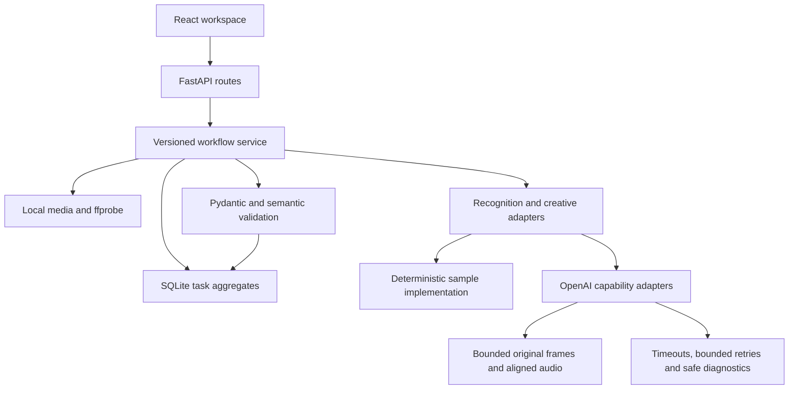

# Architecture — independent task inputs and evidence v0.6

React/Vite/TypeScript serves the browser workspace; FastAPI/Python owns the persistent task workflow. Pydantic v2 models define the v0.6 shared contract. Deterministic sample adapters remain separate from configurable OpenAI recognition/creative adapters. Without credentials, real recognition returns an explicit unconfigured result. Historical stack and frame-timing decisions remain in `docs/decisions/skeleton-v0.2.md`, `docs/decisions/frame-timing-v0.3.md`, and `docs/handoff/frame-timing-review.md`; current boundaries are documented in `docs/interfaces.md` and actual checks in the latest handoff.

## Modules and boundaries

| Module | Implementation | Responsibility |
|---|---|---|
| Web workspace | `frontend/src/` | Enter brief, play/seek original or derivative media, review event content/structured labels/section roles, compare/refine/approve directions, edit/export outputs. Contains no provider credentials. |
| HTTP API | `backend/app/api.py` | Validate request shapes and return task records or structured errors. Swagger documentation is available at local `/docs`. |
| Workflow service | `backend/app/service.py` | Enforce exact input revisions, correction restrictions, confirmation, approval, currentness, and optimistic task versions. |
| Persistent storage | `backend/app/storage.py` | Store each validated task aggregate as JSON in SQLite; transactional updates compare the expected task version. |
| Media intake | `backend/app/media.py` | Validate H.264/SDR HEVC MP4, retain originals/hash/source timing, and generate/validate an H.264 playback derivative for HEVC. |
| Provider media preparation | `backend/app/media_preparation.py` | Bounded timestamped source-frame sampling and source-aligned audio chunks with hash verification; preparation uses originals. |
| Adapter interfaces/sample | `backend/app/adapters.py` | Stable recognition and creative protocols plus explicitly labeled deterministic sample implementations. |
| Provider capabilities | `backend/app/providers/` | Independent vision/transcription protocols, OpenAI transport, semantic normalization, creative content generation, capability settings, cache and internal diagnostics. |
| Contracts | `backend/app/models.py`, `contracts/v0.6.*.schema.json` | Authoritative models, generated schemas, nested group and exact-reference validation. Frontend declarations are generated from the same schema. |
| Timing | `backend/app/timing.py`, `frontend/src/timing.ts` | Map integer reference frames to actual media timestamps; format nominal non-drop timecode. |
| Legacy migration | `backend/app/migration.py`, `backend/app/frame_migration.py`, `backend/app/contract_migration.py` | Explicit v0.1 import, archived v0.2 frame conversion and v0.3 nullable-field upgrade; never invent FPS, observations, proxy media or review. |

## M2 input boundary

The Editorial Studio input editor saves partial task-local fields and stable claim rows in `m2_drafts` in the existing SQLite database. Independent draft versions, serialized client autosaves and optimistic server checks keep typing separate from task/job writes. Raw notes and unaccepted proposals are not formal input. Explicit Apply validates and compares the complete payload atomically; meaningful changes append/invalidate, identical content preserves formal versions and approval. The checkpoint includes reviewed excluded claims.

Creative admission and approval check pending/legacy input state inside their task transaction. Existing jobs can finish while only the draft changes; changed applied input retains the original stale-result guard. Reference operations remain independent. M2 assistance uses typed bounded proposals in `providers/m2.py`; it does not write state or reuse M6 job operations. Real and explicitly injected fake providers remain separate. See [v0.5 decisions](decisions/m2-v0.5.md) and [interfaces](interfaces.md).

## Persistent workspace editors and assets

The task panel restores the active task and its last work area. Four mounted work areas keep local edits while server-backed `editor_drafts` independently persist M5 analysis corrections, each M6 direction and M7 production. A shared serialized client session preserves newer typing through delayed responses, reports conflicts, and retains local fallback text on failed requests. Explicit formal saves checkpoint the exact saved draft atomically; pending edits gate dependent creative operations. M2 keeps its own established draft contract.

The task-level English/Chinese choice is explicit before generation. Changing it invalidates creative approval and outputs while retaining reference review. Creative adapters use request-local language copies. Manual direction edits mark auxiliary explanations `needs_review`; they remain available as prior interpretation and are excluded from new production until regenerated. Original production shots may omit a reference citation.

The video collection retains tombstoned metadata when original/proxy media are deleted. Historical text, exact provenance and M2 inputs remain; dependent creative work becomes outdated and playback is unavailable. One active reference remains a stage limit, with no active library retrieval. PDF print views and CSV/Markdown exports pin saved artifact references and mark historical/source-deleted content. New paired outputs carry a shared bundle ID; legacy output pairings are never inferred from revision numbers.

## Records and persistence

Each task contains append-only content revisions for the brief, analysis, directions, feedback, and production outputs, plus current-reference pointers. Confirmation, approval, and current/outdated metadata can change without inventing a content revision. Original recognized content and earlier human edits remain available. Task versions are separate from artifact content revisions: every successful formal task mutation increments the task version; M2 draft saves and no-op Apply do not, so another tab or a delayed operation cannot silently overwrite newer work.

The default data directory is ignored `.local-data/`, configurable with `VIDEO_ANATOMY_DATA_DIR`. SQLite holds task state in `tasks.sqlite3`; originals and playback derivatives live below `media/`. Provider caches and safe run diagnostics use `provider-cache/`. Runtime data is not tracked source. Storage checks task membership and exact revision references on load and save. Startup atomically archives and migrates saved v0.2/v0.3/v0.4/v0.5 payloads to v0.6. The v0.5 path adds nullable language/deletion/bundle metadata and auxiliary review flags without guessing historical language or pairing. The v0.4 upgrade adds legacy-unrecorded claim metadata and a separate new-creative-work review gate, preserving historical approval/currentness. A v0.3 upgrade adds null structured details/playback while preserving all content, review, approval and exact citations. The v0.2 path uses matching media for frame conversion; missing or unrepresentable timing stays archived seconds with creative gates disabled. All three paths retain the exact original JSON and SHA-256 in `task_migration_archive`, increment the optimistic task version once and leave old data unchanged on failure. Historical schemas/examples remain unchanged. The demonstration uses one backend worker, without a queue, multi-user authentication or hosted deployment.

Evidence events are the sole editable recognized content. Content sections contain time intervals, role interpretation and event IDs without duplicate transcripts. Optional `visual_details` on visual-action events contains local subjects/actions/product presentations with separate status/items/error groups. Unknown labels remain null; missing structured extraction is distinct from a checked empty scene. Local relationship validation prevents dangling references and presentations of subjects lacking a product role. No speculative language/confidence fields or cross-shot identities are added.

Visual/audio events can overlap; primary sections are ordered and nonoverlapping. Atomic label corrections permit only documented category/role and explanatory text leaves. IDs, order, relationships, extraction status/errors and timing remain fixed; cumulative before/after logs must replay from the preserved original. Corrections clear review and affected interpretations and invalidate downstream approvals without deleting outputs. `chosen_direction` records draft selection; `selected_direction` records explicit approval for production. The handoff baseline table swapped their descriptions; live semantics and historical pointer values are preserved.

Source intervals remain zero-based integer frames with exclusive ends. Original presentation boundaries, rational FPS and signed media origin support constant, fractional and variable rates. HEVC playback derivatives have independent measured clocks with one-to-one presentation-frame correspondence. Recognition uses the original clock; browser seeks use the selected representation's clock with the same source-frame index. Storyboard plans remain independent seconds.

## Processing and dependency gates

Operations execute synchronously and persist processing/job results. The contract reserves pending/running/succeeded/failed job states and partial analysis coverage; creative use accepts only a current, confirmed, successful analysis. Any failed attempted top-level category or nested structured group requires a partial result while successful observations remain inspectable. Failed, incomplete, partial, stale or wrong-task analyses cannot become creative input. The adapter owns extraction coverage; unimplemented categories mean `not_analyzed`, never assumed absence.

The service checks the request's expected task version before committing results. Retrying is an explicit new operation using current inputs. Startup marks interrupted pending/running jobs failed with `interrupted_job`; it does not automatically resume them. Analysis reruns preserve the previous analysis under its original ID and create a new analysis identity. Corrected analysis creates a new revision of the same identity. Upstream changes retain downstream content, mark it outdated, and remove dependent approval. A refined direction is a new draft requiring explicit approval; selection alone is insufficient.

Production generation consumes the exact selected approved direction and its brief, analysis, and feedback revisions. Editing outputs saves new revisions. Regeneration is explicit and preserves manual work in history. Export includes origin, currentness, and source/version context; it is not an approval bypass.

## Sample and real provider paths

`scripts/generate_sample_media.py` creates a ten-second fictional illustrated clip using original bitmap labels, geometric shapes, and synthetic tones. The dedicated sample loader creates matching media and sample observations. There is no human speech, live footage, or demonstrated real product efficacy. Separate schema-only examples may contain fictional speech; they never prove playback evidence.

An ordinary upload follows real mode and cannot receive prepared sample findings. `ProviderRecognitionAdapter` uses separately configurable vision and timestamped transcription capabilities. The OpenAI implementations send bounded source JPEGs and aligned audio, preserve English/Chinese/mixed source words, normalize timestamps against original frame boundaries and retain truthful failures. Sparse frame sampling does not establish exhaustive shot boundaries or exact action duration. Music/SFX extraction remains unimplemented. A fake alternate provider verifies the capability boundary offline; no second real provider is claimed.

`OpenAICreativeAdapter` implements the existing two-direction, written refinement and production operations with exact saved evidence references. Source evidence remains separate from generated hypotheses and narrative language. The workflow service owns review, approval, currentness and persistence; provider content cannot approve itself. Models are independently configurable per capability, initially `gpt-4.1-mini` for visual/creative structured responses and `whisper-1` for timestamped transcription. Credentials stay in backend environment configuration. The transport bounds requests, output, timeouts, transient retries and concurrency and exposes safe errors without raw responses or keys.

Recognition cache keys include content hash, provider/model, preparation/prompt/schema/normalization versions, source timing and relevant settings. Run records preserve timing, attempts, cache status, safe failures and reported usage units; unavailable usage/cost is null with an explanation. Explicit opt-in, credentials, permitted media and a positive budget are required for the separate live harness. Offline fakes and synthetic bilingual cases establish integration behavior, not live accuracy, latency or cost. Provider failure never invokes sample templates; the sample path remains available without credentials.

## Coding environment and local demonstration

Cloud is the development and verification environment. Frank's Mac and Andrea's machine need their own runtimes, dependencies, media tooling, and generated sample media; Git does not transfer them. Their local browser connects to the local frontend/backend, and each installation stores its own task data. Cloud checks do not establish that either local computer is configured or tested. Public hosting, platform downloads, background job infrastructure, multi-video comparison, and model training remain deferred.
