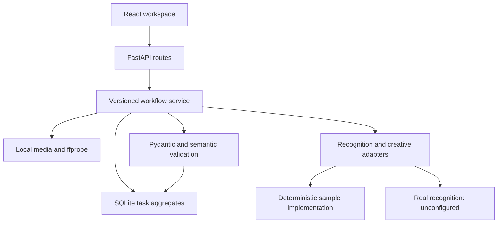

# Architecture — frame timing v0.3

React/Vite/TypeScript serves the browser workspace; FastAPI/Python owns the persistent task workflow. Pydantic v2 models define the shared contract. Deterministic sample adapters exercise the complete workflow, and the real recognition adapter returns an explicit unconfigured error. Stack choices and inspected runtime versions are recorded in `docs/decisions/skeleton-v0.2.md`; the frame-timing follow-up is recorded in `docs/decisions/frame-timing-v0.3.md` and `docs/handoff/frame-timing-review.md`.

## Modules and boundaries

| Module | Implementation | Responsibility |
|---|---|---|
| Web workspace | `frontend/src/` | Enter brief, play/seek associated media, review event content and section roles, compare/refine/approve directions, edit/export outputs. Reads/writes the backend; contains no provider credentials. |
| HTTP API | `backend/app/api.py` | Validate request shapes and return task records or structured errors. Swagger documentation is available at local `/docs`. |
| Workflow service | `backend/app/service.py` | Enforce exact input revisions, correction restrictions, confirmation, approval, currentness, and optimistic task versions. |
| Persistent storage | `backend/app/storage.py` | Store each validated task aggregate as JSON in SQLite; transactional updates compare the expected task version. |
| Media intake | `backend/app/media.py` | Validate configured limits, inspect codecs, duration, rational FPS and decoded frame timestamps with ffprobe, store files by generated identifiers, and locate playback media. |
| Provider adapters | `backend/app/adapters.py` | Normalize recognition and creative requests/results. Sample implementations are deterministic; provider transports remain behind this boundary. |
| Contracts | `backend/app/models.py`, `contracts/v0.3.*.schema.json` | Authoritative models, generated schemas, semantic and exact-reference validation. Generated frontend types share these schemas. |
| Timing | `backend/app/timing.py`, `frontend/src/timing.ts` | Map integer reference frames to actual media timestamps; format nominal non-drop timecode. |
| Legacy migration | `backend/app/migration.py`, `backend/app/frame_migration.py` | Explicit v0.1 import and automatic archived v0.2 conversion; never invent source FPS. |

## Records and persistence

Each task contains append-only content revisions for the brief, analysis, directions, feedback, and production outputs, plus current-reference pointers. Confirmation, approval, and current/outdated metadata can change without inventing a content revision. Original recognized content and earlier human edits remain available. Task versions are separate from artifact content revisions: every successful mutation increments the task version, so another tab or a delayed operation cannot silently overwrite newer work.

The default data directory is ignored `.local-data/`, configurable with `VIDEO_ANATOMY_DATA_DIR`. SQLite holds task state in `tasks.sqlite3`; media lives below `media/`. Runtime data is not tracked source. Storage checks task membership and exact revision references on load and save. Startup atomically archives and migrates saved v0.2 payloads using their matching media; missing or unrepresentable timing remains explicitly archived seconds with creative gates disabled. Old schema/example files remain unchanged. The team demonstration runs one backend worker; there is no queue, multi-user authentication, or hosted deployment in this skeleton.

Evidence events are the sole editable recognized content. Content sections contain time intervals, role interpretation, and event IDs. They do not independently duplicate transcripts. Visual/audio events can overlap; primary sections are ordered and nonoverlapping. Corrections preserve observation IDs/times/provenance and clear affected interpretation. Source intervals use zero-based integer frames with exclusive ends. The video stores decoded presentation boundaries and the browser playback origin, supporting constant, fractional and variable rates. Planned storyboard times remain seconds and do not depend on reference FPS.

## Processing and dependency gates

Operations execute synchronously for the small sample workflow and persist processing/job results. The contract reserves pending/running/succeeded/failed job states and partial analysis coverage; the operational creative gate accepts only a current, confirmed, successful analysis. Failed, incomplete, partial, stale, or wrong-task analyses cannot become creative input. The adapter owns extraction coverage; an unimplemented category means `not_analyzed`, never assumed absence.

The service checks the request's expected task version before committing results. Retrying is an explicit new operation using current inputs. Startup marks interrupted pending/running jobs failed with `interrupted_job`; it does not automatically resume them. Analysis reruns preserve the previous analysis under its original ID and create a new analysis identity. Corrected analysis creates a new revision of the same identity. Upstream changes retain downstream content, mark it outdated, and remove dependent approval. A refined direction is a new draft requiring explicit approval; selection alone is insufficient.

Production generation consumes the exact selected approved direction and its brief, analysis, and feedback revisions. Editing outputs saves new revisions. Regeneration is explicit and preserves manual work in history. Export includes origin, currentness, and source/version context; it is not an approval bypass.

## Sample media and provider replacement

`scripts/generate_sample_media.py` creates a ten-second fictional illustrated clip using original bitmap labels, geometric shapes, and synthetic tones. The dedicated sample loader creates matching media and sample observations. There is no human speech, live footage, or demonstrated real product efficacy. Separate schema-only examples may contain fictional speech; they never prove playback evidence.

An ordinary upload follows real mode and cannot receive prepared sample findings. Andrea can replace `UnconfiguredRecognitionAdapter` using the documented recognition request/result boundary without teaching the UI provider-specific formats. Frank can replace the sample creative implementation using the same exact brief/analysis/direction/feedback boundary. Paid requests and provider credentials are unnecessary for the baseline.

## Coding environment and local demonstration

Cloud is the development and verification environment. Frank's Mac and Andrea's machine need their own runtimes, dependencies, media tooling, and generated sample media; Git does not transfer them. Their local browser connects to the local frontend/backend, and each installation stores its own task data. Cloud checks do not establish that either local computer is configured or tested. Public hosting, platform downloads, background job infrastructure, multi-video comparison, and model training remain deferred.
