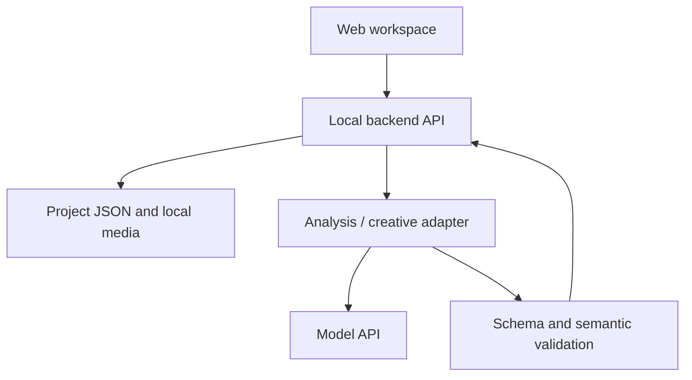

# Architecture Direction

**Candidate v0.1. The stack has not yet been selected or tested. English edition: 14 October 2026.**

Candidate stack: React + Vite + TypeScript frontend, FastAPI + Python backend, project JSON and media in local application-data directories, and a small provider adapter. Select and validate the technical approach before pinning versions, creating dependency manifests, or publishing actual setup commands.

## Modules and boundaries

| Module | Responsibility | Boundary |
|---|---|---|
| Web workspace | Collect brief/video, play video, edit segments, approve direction, display storyboard | Read/write projects through the backend API; never hold provider API keys |
| Project service | Manage stable IDs, revisions, approval state, and storage paths | BrandBrief, VideoAsset, AnalysisResult |
| Media intake | Validate input, read duration, choose file-upload or supported link path | Produce a normalized VideoAsset; give a clear failure reason |
| Analysis adapter | Call the selected model, parse/normalize output, and validate contracts | Return a consistent AnalysisResult to the UI |
| Creative workflow | Generate directions from the brief and reviewed analysis; generate storyboard after approval | Record the exact brief and analysis revisions used |
| Local storage | Store project JSON, immutable analysis revisions, and media | Configure paths so storage implementation can later be replaced |

Validate uploaded files as well as provider results. Do not assume all APIs accept arbitrary platform URLs, support strict JSON output, or return equally accurate timestamps. Implement an adapter for the selected provider first; a large multi-model platform is not an initial requirement.

## Application execution versus coding environment

For the planned local demonstration, the browser connects to the backend on the team's computer; the backend calls a remote model API. Media and project JSON are stored in configured local application-data directories.

Codex may develop and test the same code in Cloud. That Cloud coding workspace is separate from the Mac, and its working files, dependencies, and credentials are separate. Cloud development is not public application deployment. Actual Cloud integration tests need their own permitted media, dependencies, credentials, and network access.

GitHub holds code, documentation, and small synthetic fixtures. It does not automatically synchronize local media, API keys, Python environments, or application project data. When switching computers or environments, transfer necessary media/project data separately and record the method in the handoff.

## Jobs and state

Analysis can take time. Define `pending`, `running`, `succeeded`, and `failed` states and explicit retry behavior. Use measured provider latency to decide whether the UI should poll or wait for a request. A message queue is not required before a real scaling need is observed. Retries must not silently replace approved results.

## Implementation sequence

1. Test one owned or permitted clip with a candidate provider; record actual inputs, outputs, latency, and cost.
2. Use synthetic fixtures to exercise the interface and contracts for brief entry, analysis correction, direction approval, and text storyboard output.
3. Replace fixtures with a real adapter; check observation versus interpretation, timestamp accuracy, and failure messages.
4. Verify save/reopen, stale-output handling after revisions, and reproducible startup instructions.

These are planned implementation steps. This documentation package has not implemented or tested the application. If link ingestion fails, record the conditions and use the tested file-upload fallback rather than claiming universal platform support.
