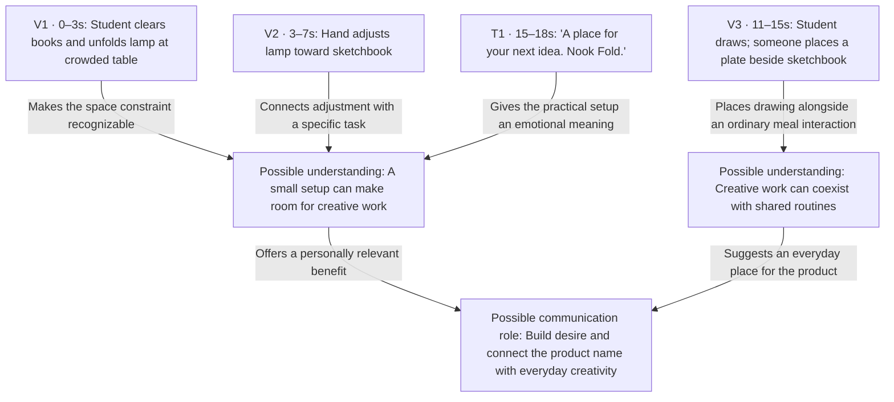

# Fictional development exercises

All brands, source IDs and source packets below are fictional. Outputs are the
actual text returned by three separate fresh subagents, lightly formatted as
document sections only. No product-model call, video inspection or online research
was performed. This file is evaluator material; do not include it in generation
requests or treat its answers as ground truth.

## Common task conditions
Each agent was directed to read the package entry point and its specified shared
and module guides, then produce the user's requested artifact. Each had only its
own inputs below, with no expected answer, parent-chat context or grading hints.
File edits, browsing and paid APIs were disallowed.

## Structure input
Video A17, 18 seconds. Source times in seconds; FPS not supplied.
- V1, 0–3s: crowded kitchen table; a student moves books aside and unfolds a small lamp.
- V2, 3–7s: hand adjusts lamp head toward an open sketchbook.
- Visual samples and OCR missing at 7–11s.
- V3, 11–15s: same student draws; someone sets a plate beside the sketchbook.
- T1, 15–18s: "A place for your next idea. Nook Fold."
- A1: instrumental music throughout; no speech.
- C1, supplied fictional company product sheet: adjustable head, folding base;
  company claims up to 24-hour battery life; no independent test.
- C2, supplied fictional about page: objects for shared living spaces.
No campaign brief or audience research. Request: explain goal, audience, element
functions and lessons; keep it clean and easy to read.

### Returned Structure output
**Nook Fold appears to make personal creative space feel possible within shared daily life.** The crowded table, adjustable lamp and sketchbook support that reading. A parallel interpretation is that the ad presents the lamp as an object that fits naturally into shared routines. Neither is a documented campaign objective.

This is a partial analysis of **A17, 18 seconds**. Visual samples and OCR are missing from **7–11s**, so the complete progression and any intervening message are unknown. Context is limited to the supplied company materials, C1 and C2.

The relationships below explain how the available evidence supports those readings:

The likely audience is **people seeking room for focused or creative activity in shared spaces**. The student provides one recognizable example; the footage does not establish a student-only audience or a demographic target.

The opening can earn attention through a familiar inconvenience: making space on a crowded table. The later drawing scene provides a possible payoff, although the missing middle prevents a confident account of the transition. The hand adjustment gives the product a practical role; the plate keeps the creative activity connected to ordinary shared life. Instrumental music without speech (A1) leaves the explanation to images and the closing text. The supplied audio description does not establish a particular mood.

C1 supports the adjustable-head and folding-base interpretation. Its **“up to 24-hour battery life” is a company claim**, with no independent test supplied; the available footage does not demonstrate it. C2’s shared-living positioning makes the setting consistent with the brand’s stated purpose, without proving campaign intent or effectiveness.

Two useful lessons transfer:

- **Show a feature serving a recognizable task.** Adjusting the head toward the sketchbook (V2) connects operation with use. This works when the action is legible; copy that connection, not necessarily the hand close-up. It demonstrates adjustment, not lighting quality or improved creativity.
- **Make the setting carry the audience’s situation.** The crowded table and nearby plate (V1, V3) suggest competing uses of shared space. Choose an equivalent tension relevant to your audience rather than copying the kitchen. If the product has no meaningful role in that tension, the setting risks becoming decoration.

## Ideas input
Brief B8: Rivet Daybag, reversible tote, adjustable strap, one removable inner
pouch. No approved waterproofing, anti-theft, weight or price claims.
Objective: make the reversible design relevant beyond decoration.
20-second vertical social ad in English; audience unspecified; one actor, one room,
one bag available. Selected reference method R2 uses a dramatic rain test for
another product with supported water resistance.
Request: two strong different directions, borrowing the dramatic reveal; short
but clear enough to choose.

### Returned Ideas output
For B8, I’d borrow **R2’s suspense and dramatic reveal**. Its rain test would imply water resistance, which isn’t approved for Rivet.

Working assumption: the audience values changing their look. These directions address two different reasons to care about reversibility.

**1. “The plan changed.”**  
*The same bag can offer another side when the day takes a different turn.*

Open on the actor ready to leave. Text: **“Ready for the plan.”** Then: **“Change of plan.”** They pause, reverse the Rivet Daybag and face the camera again. End: **“New plan. Same bag.”**

The reversal resolves a small story, giving it a reason beyond visual novelty. This is the more relatable, situational direction. Choose the actual plan change after seeing the bag’s two sides; neither side should be assumed to look formal or casual.

**2. “You don’t have to choose forever.”**  
*Choosing one look today doesn’t mean committing to it tomorrow.*

Open with two consecutive product portraits: **“This one?”** and **“Or this one?”** The actor appears to be deciding between bags. The reveal shows the actual reversal: both choices belong to one Rivet Daybag. End: **“Pick a side. Change your mind.”**

This turns reversibility into freedom from a fixed choice. It offers the stronger surprise: the reveal changes what the viewer thought they were comparing.

Both fit a 20-second vertical ad with one actor, one room and one bag, using separate takes. The reveal depends on the sides being visibly distinguishable; use their actual appearance and rehearse the reversal before scripting. Neither direction needs added product claims.

## Storyboard input
Fictional B8, explicitly approved D3 revision 4. Same approved Rivet product facts.
Approved concept: "One room, two moods": one actor reverses the bag as colored light
changes; the same bag is the visual anchor. 12 seconds, English, one actor/room,
adjustable lighting available. Fixed end card: "Rivet Daybag. Choose your side."
Experimental: uncertain association of mood change with reversible design.
Hypothesis: visible reversal builds the association. Proposed rough-cut association
check with intended viewers has not happened.
Request: Shot/Time/Visual/Audio, minimal notes, and mandatory new VO with no deletions:
"From your first morning meeting to an unexpected evening plan, carry the things
that matter in a bag that lets you choose the side you want to show, whenever your
mood changes and wherever your day might take you next."
No measured audio. Approved concept and fixed end card remain unchanged.

### Returned Storyboard output
**One room, two moods — B8 / approved D3 revision 4.** Planned duration: **12 seconds**. **Discussion draft:** the new, mandatory 40-word VO requires an average 200 words/minute before pauses. Its fit across S01–S04 is unverified; no measured audio was supplied.

| Shot | Time | Visual | Audio |
| --- | --- | --- | --- |
| S01 | 0–3s | Medium, locked frame. One actor holds the Rivet Daybag at waist height, first face toward camera. Warm colored light fills the room. | VO: “From your first morning meeting to an unexpected evening plan,” |
| S02 | 3–7s | Close framing on hands and bag. The actor visibly reverses the same bag in one continuous shot. Keep the action unobstructed; hold the warm lighting until the second face is revealed. | VO: “carry the things that matter in a bag that lets you choose the side” |
| S03 | 7–9.5s | Return to the original medium framing. As the actor presents the second face, the room changes to cool colored light. Bag remains in the same central position. | VO: “you want to show, whenever your mood changes” |
| S04 | 9.5–12s | Hold actor and reversed bag still under cool light. Overlay the fixed end card: **“Rivet Daybag. Choose your side.”** | VO: “and wherever your day might take you next.” |

Audio cells form one continuous, verbatim VO; cue points are estimates.

- **S02:** Rehearse the reversal to establish whether four seconds is sufficient. Use the same empty bag throughout, with its removable pouch set aside before filming.
- **Resources:** One actor, one room, one Rivet Daybag, camera/support and the available adjustable lighting.
- **Experimental status:** The hypothesis is that seeing the reversal connects the mood change with the reversible design. That association remains untested; check it with intended viewers using a rough cut.

**Decision needed:** Keep 12 seconds and test the brisk VO delivery, or allow approximately 16–18 seconds for a more relaxed read? Every word, the approved concept and the fixed end card remain preserved.
