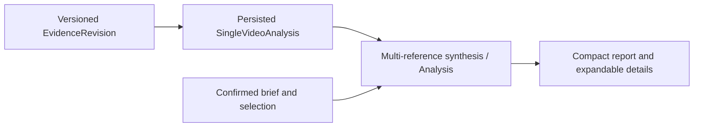

# Layered analysis and migration

The application stays a modular monolith: React/Vite/TypeScript, FastAPI/Python, project aggregates in SQLite and existing provider adapters. No service split, hosted storage or rendering backend is introduced.

A source core captures its original hash, exact evidence version/content, model, instruction digest, language, analysis configuration and visual-only choice. It receives no project brief. Single-reference and multi-reference entry points share this core use case. A bounded worker pool analyzes sources; SQLite updates remain serialized through the store. Completed cores are durable before synthesis starts. Failed or stopped attempts remain visible and are never replayed on application startup.

Synthesis consumes compact core insights/structure summaries plus a bounded citation index. It does not submit every raw transcript or regenerate every graph in one request. Host validation resolves every accepted citation against its captured resource, evidence revision and event. Project adaptation belongs to this stage. The resulting existing `Analysis` record represents the synthesis and records exact source-core IDs, selection revision/scope, confirmed brief revision and configuration. The parent synthesis job freezes the same typed input manifest before a provider request, so failed and stopped attempts retain their exact version bindings. Saving checks current inputs; an obsolete task cannot replace current work.

Core reuse does not depend on project brief. Changing one source invalidates that source's core and dependent syntheses; unrelated cores remain reusable. A report-only retry skips recognition and reuses valid cores. Invalid/missing input stages require the explicitly requested operation rather than startup replay. Evidence, paid provider results and all prior reports stay durable when previews are cleared.

`models.py` is authoritative. `contracts/v1.8.project.schema.json` and `frontend/src/project/contracts.ts` are generated. New collections/fields have defaults: old projects load with an empty `single_video_analyses` collection, empty core bindings and unknown report-version provenance. Historical jobs default to `inputs=null`; no original failed-run input snapshot is invented. Migration never derives a fictitious paid core from a legacy report. Existing task schema families, original media, evidence histories, pack revisions and approvals remain intact.

Independent editor versions continue to protect individual drafts. The client may retry once after an aggregate version conflict only after checking the exact target scope is unchanged; it retains the original editor precondition. A real competing draft/selection is not rebased. Formal evidence/production saves still validate source revisions and editor versions.

Runtime diagnostics separate queue, extraction, source analysis, synthesis, validation and save phases. Network timeout and maximum attempt configuration are distinct fields. Operational support exports use explicit allowlists; prompts, provider response bodies, source text, local paths and credentials are excluded. Unknown usage/cost remains unknown.
