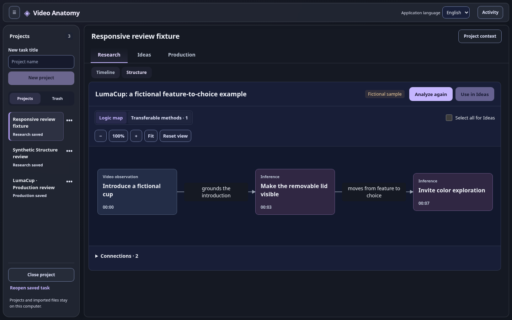
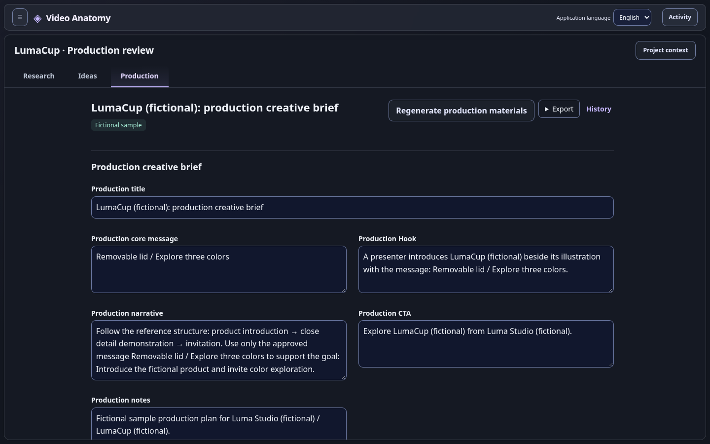

# Workspace readability and scrolling

- Task: implement the owner's approved readability review for Structure, Timeline, Ideas, Production, and the shared shell.
- Author and date: Codex, 2026-11-03 (America/Los_Angeles).
- Repository: `Frankwu899/586-project`.
- Environment: Codex Cloud Linux; Node 24.19.0, npm 11.9.0, Python 3.12, system Chromium and FFmpeg.
- Branch: `fix/workspace/readable-flexible-workspace`.
- Starting revision: current upstream `main`, `542d7ec`. The initial review used `bcd4f62`; the intervening upstream changes were documentation only.

## Result

The shell has one vertical reader on desktop and document scrolling in narrow or short windows. Project navigation can collapse, long titles wrap, global errors remain visible with the sidebar closed, and context remains a keyboard-accessible drawer. Routine saved/version text and the development footer are removed. Neutral dark surfaces replace strong background glows; text and control borders use consistent contrast tokens.

Structure uses measured, wrapping node and relationship text, a layered layout without the previous four-column cap, and separate routes for back/cyclic edges. Labels remain at least 14px in the default and automatic Fit view. Zoom, readable Fit, Reset, pointer/trackpad/keyboard panning, and an accessible Connections list are available. Users can explicitly zoom out farther; automatic fitting never forces that reduction. The inspector opens on selection, resizes on desktop, and becomes a dismissible modal on narrow screens. Small graphs no longer occupy an unnecessarily tall canvas.

Timeline uses the same dark surfaces for empty, importing, loading, usable, partial, and failed states, with one local operation announcement. Evidence details can close and resize. Narrow/short windows read player, timeline, then evidence without a nested evidence scrollbar. A failed rerun can expose retained same-video evidence in an explicitly historical, read-only view; it does not attach that evidence to the current correction draft. Provider/method details move to Diagnostics and the repeated timing disclaimer is removed. Sampling semantics, meaningful uncertainty, and timestamps remain intact.

Production starts with the material title and Generate/Regenerate, Export, and History controls. A single prerequisite identifies the actual next action, including failed context loading, unapplied context, selected idea drafts, approval, generation language, and reference corrections. An original idea does not inherit unrelated reference requirements. Existing materials, explicit approval, retained drafts, and save-before-export checks remain in place. Ideas has the same quieter copy and reports pending state for the exact approved direction revision. English/Chinese interface strings are updated without changing authored evidence or generated content.

## Layout contract

- Above 900px width and 700px height, `.workspace-body` owns normal reading scroll. Workspaces do not add another vertical document scroller.
- At or below either threshold, the document owns normal vertical scrolling. Navigation stays reachable and workspace tabs stick to the top.
- Graph panning, timeline horizontal navigation, the project list, dialogs, and optional wide-screen inspectors retain their specialized scrolling.
- The project sidebar becomes a drawer below 1051px. Graph inspector drawers use a 900px breakpoint. Controls and content wrap instead of shrinking to fit a fixed height.

This supersedes earlier blanket no-document-scroll acceptance assertions. Tests should verify content and control reachability, horizontal containment, and preserved state rather than insist that every view fit one screen.

## Scope and files

Frontend components, shared shell/theme styles, localized interface strings, and focused unit/browser regressions changed. New modules are `LogicGraph.tsx`, `structureLayout.ts`, and `productionReadiness.ts`. `M2EditorStatus` adds an optional frontend error field so a failed context load is not presented as perpetual loading. No backend models, API contracts, dependencies, generation providers, or stored-data formats changed.

## Verification

Validation uses isolated temporary databases and the explicitly fictional sample or mocked providers. No paid model calls or real-media quality evaluation are part of this task.

| Check | Command or procedure | Observed result |
|---|---|---|
| Dependencies and schema | `.venv/bin/python -m pip check`; `.venv/bin/python scripts/export_contracts.py --check`; `npm --prefix frontend run contracts:check` | Passed |
| Backend lint and tests | `.venv/bin/python -m ruff check backend tests scripts`; `.venv/bin/python -m pytest -q` | Passed; 729 tests passed, 1 skipped; existing Starlette/httpx deprecation warning |
| Frontend units | `npm --prefix frontend run test:unit` | 41 passed |
| Types, lint, bundle | `npm --prefix frontend run typecheck`; `npm --prefix frontend run lint`; `npm --prefix frontend run build` | Passed |
| Default browser suite | `npm --prefix frontend run test:e2e` | 53 passed; two test navigation/locator assumptions needed adjustment |
| Browser follow-up | `npm --prefix frontend run test:e2e -- e2e/workspace-reading.spec.ts e2e/workspace-recovery.spec.ts` | 3 passed, covering both corrected cases; all 55 default checks covered without further application changes |
| Mocked providers | `npm --prefix frontend run test:e2e:providers` | 4 passed, including HEVC playback, bilingual corrections, approval, exports, stale results and recovery |
| Manual Chromium review | 1440×900, 1280×720, 1024×768, 390×844, 720×450; graph pan/zoom/Fit, inspector resizing, Escape/focus recovery, retained selection, long evidence, console errors | No page horizontal overflow or console exceptions observed; controls reachable; narrow/short evidence uses document flow |
| Contrast spot checks | Computed foreground/background colors on representative body, metadata, graph, timestamp and controls | Text ratios 7.51–15.39:1; secondary borders 3.80–3.96:1 and inputs 4.15:1 |

The backend/static stages were run through `bash scripts/verify.sh`; browser suites were rerun separately after updating assertions for the new navigation and copy. The script is not reported as a single uninterrupted successful run. No paid calls were made.

Not established: native macOS installer behavior, real provider quality/latency, screen-reader testing with assistive software, or a general performance benchmark. A small effective viewport exercises zoom-related reflow but is not proof of browser chrome zoom behavior.

## Delivery

No merge or deployment is included. The repository changes travel through the review branch and PR; local environments, source media, temporary task data, credentials, and the historical budget ledger are not included. The containing PR records the final commit and verified remote branch. No unrelated working-tree changes or conflicts were present. The base was synchronized with upstream `main` before implementation.

Temporary preview data uses `/tmp/video-anatomy-ux-preview`; browser tests use their own temporary directories. Environment variable names used for isolated tests are `VIDEO_ANATOMY_DATA_DIR`, `OPENAI_API_KEY`, `RUN_LIVE_MODEL_TESTS`, and `API_PROXY_TARGET`. Only fictional sample screenshots are included below.

The next step is owner review of the PR and a local retained-library smoke check on this branch using `README_SETUP.md`. There are no open implementation decisions. Native macOS, assistive-software and actual browser zoom checks remain unperformed as noted above.

## Review screenshots

Structure at 1440×900, with wrapping labels at 100% and the inspector closed:

Production at 1440×900, with the project sidebar collapsed:

