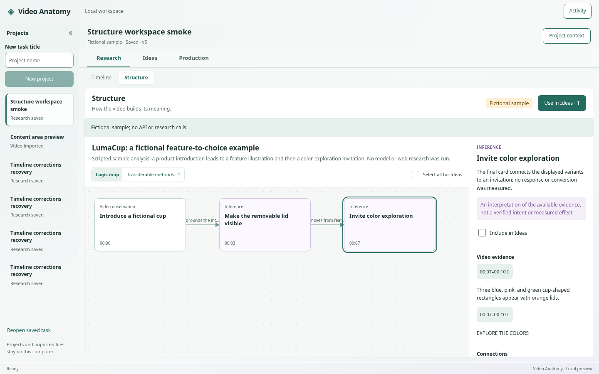
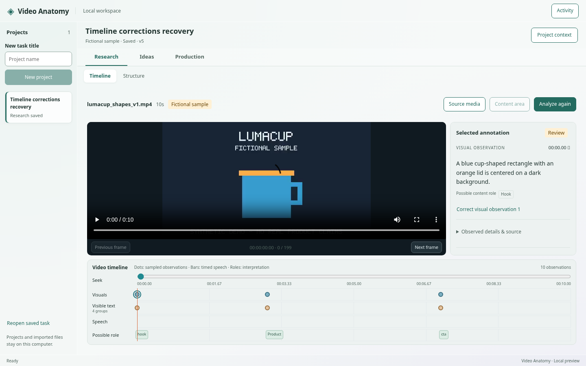

# Independent workspace and Structure agent — 2026-10-18

This revision implements the owner's workspace redesign and confirmed Structure
S1–S11 decisions. It starts at `a636ff1`, above the unmerged PR #7 citation fix.
Review it as a stacked change; `main` remains untouched. The owner authorized a
single USD 3 experiment budget for this task, not separate budgets per agent.

## User-visible changes

- Research, Ideas and Production are independent work areas in a bounded desktop
  shell. Project context opens in a drawer. Tasks, tabs and editor drafts recover
  across navigation and restart. Activity and errors appear beside the affected
  work, with a compact global activity list.
- Research has Timeline and Structure tabs. Timeline combines a player, bottom
  evidence tracks and a selected-item inspector. Sparse visual samples remain
  points; measured speech intervals remain intervals. Repeated OCR is grouped
  without replacing its original evidence records.
- Content area provides a non-destructive crop, exclusion masks and conservative
  local edge-bar suggestions. Stationary product text, logos and subtitles are
  not automatically classified as interface noise. Recognition uses transformed
  frame images while original files, source times and audio remain unchanged.
- Structure explains the source video's relationships and transferable methods.
  It first publishes video-grounded work, then researches only material context
  gaps. Observations, attributed claims, user context and inference are distinct.
  Background failure or limits retain completed work without an extend-research
  control. Optional node questions and reconsideration produce previewable
  proposals; users do not need to maintain a graph manually.
- Selected Structure nodes/methods carry sources and applicability conditions
  into Ideas. A direction pins the original selection for refinement and
  production; subsequent research selections do not silently replace it.
- Ideas supports a persistent notebook before any reference or completed brief.
  Applied context can generate original directions without a video. Reference
  citations require the exact reviewed analysis; original work cannot invent
  citations. Production still requires explicit approval of the exact saved
  direction. Changed reference inputs do not invalidate unrelated original work.
- Long operations return persisted tickets. Reloading polls saved activity;
  restarting never automatically replays a potentially billable request. Jobs
  reject changes to their own saved inputs, while unrelated task edits are kept.

## Local files and delivery

Imports are managed copies, not links to the user's source filename. Moving the
original phone download does not disconnect an already imported reference. The
new macOS library defaults to `~/Library/Application Support/Video Anatomy/`,
outside the extracted application. Old-library import keeps the source and
verifies the copied database/media. It refuses to replace an existing library.

If managed media is missing, Locate original restores only bytes matching the
saved SHA-256. A different video must be imported as a new reference. Historical
analysis and approvals are not transferred to different bytes. See
[local delivery](local-desktop-delivery.md) and [local instructions](../../LOCAL_API.md).

The final local ZIP contains the built browser UI and English launcher/docs.
Electron source and macOS build preparation are included. A native `.app`/DMG,
Mac Keychain behavior, signing, notarization and clean-Mac installation have not
been executed in this Linux environment. The ZIP is not represented as a DMG.

## Contracts and compatibility

Current generated contracts are v0.7. Existing v0.6 records remain accepted,
and historical schemas/examples are preserved. Additions include optional
reference input for creative work, a retained idea notebook and a pinned
Structure handoff ID. Structure runs, history, context and proposals have their
own durable SQLite tables. The source-frame and production-second clocks remain
separate. See [interfaces](../interfaces.md).

## Evaluation and remaining acceptance

See [module evaluation](../evaluation/MODULE_TEST_REPORT.md) for the actual live
status and [corpus](../evaluation/corpus.md) for sources, rights and controls.
The corpus includes both owner clips and a public CC advocacy film excerpt.
A manually masked Guandan variant is a paired control, not an independent clean
video or evidence that automatic cleaning works. Unavailable online videos are
listed as candidates rather than counted as tested inputs.

This task has not sent a paid request or trained/fine-tuned a model: the current
Cloud environment lacks the project API secret and permitted OpenAI connection.
Offline provider tests validate contracts, request boundaries and accounting;
they do not establish model accuracy, latency, marketing effectiveness or cost
per successful real-video result. Prompt and evidence-boundary improvements are
implemented and await the bounded live evaluation.

The prepared experiment ledger is retained at
`.local-data/evaluation/live-experiment/provider-budget.sqlite3`. All subsequent
paid tests for this task must reuse it. Never reset it between modules or runs.
The final verification record below must be read together with these limits.

## Verification record

Actual browser captures below use explicitly fictional offline media. They show
the implemented layout, not live model quality.

The full backend run passed **545 tests** in 106 seconds. A subsequent guard
hardening prevents injected real/custom HTTP clients from bypassing accounting;
**139 affected tests** passed after that change, including its new regression.
These are overlapping suites and must not be added together. The full run had
the project key removed and live testing disabled. One existing Starlette/httpx
deprecation warning remains.

Generated-schema/type checks, dependency consistency, Ruff, TypeScript, ESLint,
the production Vite build and all six frontend unit-test files passed. Three
desktop helper tests and four deterministic-provider browser tests also passed.
All **29 distinct default browser scenarios** passed across the first run
(24 passed, five failed) and affected reruns. The initial failures exposed four
outdated test assumptions and a hidden-context loading race; the race and tests
were fixed. All four direction scenarios and both connected workflow scenarios
were rechecked after the final reference-choice changes. This was not one clean
29-case run. Together with the four provider scenarios, 33 distinct browser
scenarios passed.

The final `video-anatomy-v0.7-macos-local.zip` was extracted into a fresh location
and started offline against an isolated library. API startup, owner-video import
without analysis/jobs, a sample Structure graph and independent notebook
save/reload passed with no browser errors or external browser requests. Archive
hashes, executable launcher permissions and secret/runtime-data exclusions were
verified. The private owner clip is included in this local ZIP and excluded from
Git. No provider ledger or paid request was created by the bundle smoke test.
Actual Mac native execution and live provider quality are not implied by these
checks.

Human UX acceptance, actual Mac installation, real OCR/speech/structure quality,
search relevance and measured paid-module performance remain outstanding.
No merge into main or public deployment is authorized or performed.
